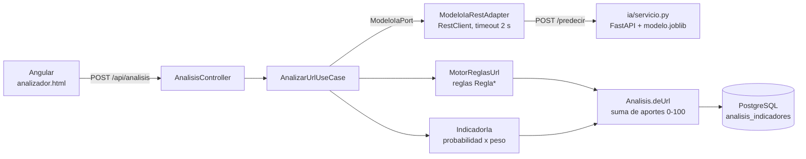

# Informe de la aplicación de Machine Learning en PhishShield Bolivia

**Materia:** Proyecto Integrador — UNIFRANZ
**Estudiante:** Marcos Vargas
**Proyecto:** PhishShield Bolivia, detección de phishing para el contexto boliviano
**Parte que desarrollé:** el módulo de IA (`ia/`) y su integración con el backend

---

## 1. Introducción

PhishShield Bolivia recibe un enlace (por ejemplo, uno que llegó por SMS o por correo) y dice
si es seguro, sospechoso o phishing, explicando por qué. Antes de este trabajo, la decisión la
tomaba solo un motor de reglas escrito en Java (`MotorReglasUrl` y las clases `Regla*` del
paquete `analisis/domain/service`). Cada regla mira algo concreto: si la URL usa una IP, si no
tiene https, si la extensión es de las más abusadas, si el dominio se parece al de un banco
(typosquatting) o si está en la lista negra. Cada una suma un peso que se lee de la tabla
`reglas_deteccion`, y el veredicto sale del puntaje total: sospechoso desde 40 y phishing desde
70 (`Resultado.java`).

Las reglas tienen una ventaja grande: se pueden auditar. Pero solo atrapan lo que alguien
pensó de antemano. Un dominio como `bancounion-bo-actualizacion.com` no está en ninguna lista y
no se parece letra por letra a `bancounion.com.bo`, así que las reglas le dan poco puntaje.
Para estos casos sirve el Machine Learning: un modelo entrenado con miles de dominios de
phishing reales aprende combinaciones de rasgos (largo, guiones, palabras como "verificar" o
"seguro", secuencias de letras típicas) que no conviene escribir regla por regla.

La idea no fue reemplazar las reglas, sino agregar **una señal más**: el indicador
`IA_MODELO_URL`. En la guía de la demo (`docs/guia-demo.md`) está el ejemplo de
`https://bancounion-bo-actualizacion.com/datos`: sin la IA queda como sospechoso con 45
puntos, y con la IA llega a phishing con 75,61.

## 2. Datos

Usé el **PhiUSIIL Phishing URL Dataset** (Prasad y Chandra, 2024), publicado en el repositorio
de la UCI con licencia CC BY 4.0. El script `descargar_datos.py` lo baja y guarda su SHA-256 en
`datos/dataset_info.json` (`a236549c…d06d1c6`), para saber si alguna vez cambia el archivo. El
CSV pesa unos 57 MB y no se sube a git.

El CSV trae 56 columnas, pero solo usé `URL` y `label`. Varias de las otras 54 salen de
descargar la página, y en PhishShield, en el momento del análisis, solo tenemos la URL.

**La etiqueta está invertida.** La documentación de UCI dice que `label = 1` es una URL
legítima y `label = 0` es phishing. Lo comprobé con ejemplos (`metamask-usa-walet.godaddysites.com`
tiene label 0) y en `entrenar.py` la invierto con `df["y"] = 1 - df["label"]`, para trabajar
con 1 = phishing, que es lo natural.

**Limpieza.** Como el modelo solo mira el host (ver sección 3), dos URL con el mismo host son la
misma entrada para él. La función `cargar_y_limpiar()` de `entrenar.py` hace estos pasos:

| Paso | Filas |
|---|---|
| Original | 235 795 (134 850 legítimas, 100 945 phishing) |
| Sin URL duplicadas | 235 370 |
| Sin hosts con etiqueta contradictoria (58 hosts) | 235 211 |
| Un registro por host | **219 036** (134 792 legítimas, 84 244 phishing) |

Los 58 hosts contradictorios aparecían una vez como legítimos y otra como phishing. Si el modelo
solo ve el host, esas filas no se pueden aprender, así que las quité. Al final quedan 175 451
dominios registrables distintos (por ejemplo, `a.web.app` y `b.web.app` comparten el dominio
registrable `web.app`).

## 3. La decisión clave: usar solo el dominio

Esta fue la parte más importante del trabajo, y la que más me costó entender.

Al revisar el dataset encontré que **todas** las URL legítimas tienen la forma
`https://www.dominio.tld`, sin ruta: el 100 % usa https, el 100 % tiene `www.` y ninguna tiene
ruta. En cambio, el 60 % de las de phishing sí tiene ruta y el 51 % no usa https. O sea, un
modelo que vea la URL completa puede sacar notas altísimas aprendiendo una sola cosa: "si tiene
ruta, es phishing". Eso es verdad dentro del dataset, pero en la vida real es falso: casi
cualquier enlace que llega por correo o SMS tiene ruta, incluidos los del banco.

No quise decidirlo a ojo, así que armé un **experimento de control** dentro de `entrenar.py`
(función `control_url_completa`). Entreno la misma Regresión Logística, pero con la URL
completa y con las características de ruta y https (`CARACTERISTICAS_URL` en
`caracteristicas.py`), y la comparo con el modelo que usa solo el host. Además de la validación
de PhiUSIIL, uso `datos_evaluacion/bolivia.csv`, un conjunto de 44 URL bolivianas que armé y
etiqueté a mano, 10 de las cuales son páginas legítimas con ruta real, por ejemplo
`https://www.bancounion.com.bo/BancaDigital/UninetPlus`.

| | F1 validación | PR-AUC validación | Legítimas bolivianas con ruta marcadas como phishing |
|---|---|---|---|
| Control (URL completa) | 0.9822 | 0.9953 | **10 de 10** |
| Modelo elegido (solo host) | 0.7342 | 0.8426 | 2 de 10 |

A primera vista el control es mucho mejor. Pero ese 0,98 no mide lo que parece: en validación
las legítimas tampoco tienen ruta, así que el atajo funciona igual. Apenas salgo del dataset,
el atajo falla siempre: las 10 páginas bolivianas legítimas con ruta son 10 falsos positivos.
Con el modelo solo de dominio son 2, y los dos vienen de `bg.com.bo`, que falla igual con o sin
ruta. En el conjunto boliviano completo, el control tiene precisión 0,6154 y F1 0,7273; el
modelo elegido, precisión 0,8235 y F1 0,8000.

Por eso el modelo recibe **solo el host normalizado**: en minúsculas, sin esquema, sin `www.`
y sin puerto (`normalizar()` y `texto_host()` en `caracteristicas.py`). La información de la
ruta y del https no se pierde: la evalúan las reglas `URL_RUTA_SENSIBLE` y `URL_SIN_HTTPS` del
backend, con pesos que se pueden revisar. Entre una cifra alta que no se sostiene fuera del
dataset y una más baja que sí, elegí la segunda.

Este mismo análisis me llevó a otra decisión: las 608 URL con IP del dataset son todas
phishing, así que el modelo le da casi 1,0 a cualquier IP, incluso a `192.168.1.1`. Por eso el
backend no le pregunta a la IA por IP literales y deja ese caso a la regla `URL_IP_LITERAL`.

## 4. Diseño del modelo

### Características

Todo el cálculo está en `caracteristicas.py`, que no usa la red (`tldextract` trae su propia
lista de sufijos públicos). Lo usan tanto `entrenar.py` como `servicio.py`, para que el modelo
vea en producción exactamente lo mismo que vio al entrenar. Hay dos tipos:

1. **Diez características léxicas del host** (`CARACTERISTICAS_HOST`): largo, puntos, guiones,
   dígitos, caracteres especiales, cantidad de subdominios, si es una IP, si el TLD es de los
   abusados (la misma lista que `ReglaTldSospechoso` del backend), la entropía de Shannon y
   cuántas palabras sensibles contiene (login, verificar, cuenta, seguro, banca…). Se
   escalan con `StandardScaler`.
2. **N-gramas de caracteres del host** con `TfidfVectorizer` (`char_wb`, de 3 a 5 caracteres,
   máximo 20 000 términos, `min_df = 5`). Con esto el modelo aprende secuencias como `.xyz`,
   `-go` o `logi` sin que yo tenga que escribirlas.

Las dos partes se juntan en una sola matriz dispersa en `Detector.matriz()` (`modelo.py`).

### Clasificador, calibración y umbral

El clasificador es una **Regresión Logística** de scikit-learn (Pedregosa et al., 2011). En
`entrenar.py` comparo tres valores de regularización (C = 0,3, 1 y 3) contra un
`HistGradientBoostingClassifier` entrenado con las características léxicas. La regla que
programé es preferir la Regresión Logística salvo que el otro modelo gane por 0,02 de F1 o más;
si eso pasa, el script se detiene, porque solo sé explicar la Regresión Logística.

La salida de la regresión se **calibra con el método de Platt**: se ajusta
`p = sigmoide(a · logit + b)` en una mitad de la validación (`ajustar_platt()`). Calibrar sirve
para que "0,9" signifique de verdad algo cercano a un 90 % de casos de phishing, porque en el
backend la probabilidad se multiplica por un peso.

El **umbral** se elige en la otra mitad de la validación con `elegir_umbral()`: el mayor recall
posible manteniendo una precisión de al menos 0,90 (`PRECISION_MINIMA` en `entrenar.py`). En
palabras simples: acepto como mucho una falsa alarma de cada diez avisos y, con esa condición,
atrapo todo el phishing que se pueda. El resultado fue **0,5527**.

### Señales explicables

Quería que el usuario viera *por qué* la IA marcó un enlace, igual que pasa con las reglas. En
una Regresión Logística el logit es la suma de coeficiente × valor de cada característica, así
que cada término es el aporte exacto de esa característica (no una aproximación). El método
`Detector.explicar()` de `modelo.py` hace esto:

1. Multiplica los coeficientes por los valores de la fila (`aportes = coef[indices] * valores`).
2. Ordena primero las que empujan en la dirección del veredicto, de mayor a menor aporte.
3. Convierte cada una en una frase. Las léxicas pasan por `describir()` de
   `caracteristicas.py` ("tiene 5 subdominios (bnb.com.bo.verificar.cuenta)") y los n-gramas
   se describen como "el dominio contiene '.bo', secuencia frecuente en phishing". Los n-gramas
   que se solapan ("logi", "login", "ogin") cuentan como uno solo.

El servicio devuelve entre 3 y 5 señales, cada una con su aporte en escala logit. Por ejemplo,
para `http://bnb.com.bo.verificar.cuenta.segura-login.xyz/` la señal más fuerte es "tiene 5
subdominios (bnb.com.bo.verificar.cuenta)", con un aporte de 16,538 (`ia/README.md`).

## 5. Entrenamiento y métricas

Todo se ejecuta con `python entrenar.py`, con semilla fija (`SEMILLA = 42`) y versiones fijas en
`requirements.txt` (Python 3.14.3, scikit-learn 1.9.1). Las cifras de esta sección salen de
`ia/reporte_metricas.md` y `ia/modelos/1.0.0/metadata.json`, que el script genera solo.

### División sin fuga de datos

Si `a.web.app` cae en entrenamiento y `b.web.app` en prueba, el modelo "reconoce" `web.app` y la
prueba sale inflada. Por eso la función `dividir_por_grupo()` reparte por **dominio
registrable**, buscando un 70/15/15 en filas, y el script verifica con `assert` que ningún
dominio quede en dos particiones.

| Partición | Filas | Phishing | Dominios |
|---|---|---|---|
| Entrenamiento | 153 283 | 59 088 | 122 807 |
| Validación | 32 897 | 10 033 | 29 936 |
| — mitad para calibrar | 16 448 | 4 977 | 14 980 |
| — mitad para el umbral | 16 449 | 5 056 | 14 956 |
| Prueba | 32 856 | 15 123 | 22 708 |

### Comparación en validación (umbral 0,5, sin calibrar)

| Modelo | Exactitud | Precisión | Recall | F1 | PR-AUC |
|---|---|---|---|---|---|
| Regresión Logística, C = 0,3 | 0.8569 | 0.9182 | 0.5828 | 0.7130 | 0.8375 |
| Regresión Logística, C = 1 | 0.8622 | 0.9011 | 0.6157 | 0.7315 | 0.8429 |
| **Regresión Logística, C = 3** | 0.8605 | 0.8765 | 0.6317 | **0.7342** | 0.8426 |
| HistGradientBoosting (léxicas) | 0.8297 | 0.8851 | 0.5076 | 0.6452 | 0.7500 |

Ganó la Regresión Logística con C = 3, por tener el mejor F1. HistGradientBoosting quedó 0,0890
de F1 por debajo.

La calibración casi no cambió nada, porque el modelo ya estaba bien calibrado: el ECE pasó de
0,0168 a 0,0150 y el Brier se quedó en 0,1074 (a = 0,9464, b = −0,0181). Con el umbral 0,5527,
en la mitad de validación reservada se obtuvo precisión 0,9001 y recall 0,6007.

### Evaluación en prueba (una sola vez)

| Exactitud | Precisión | Recall | F1 | ROC-AUC | PR-AUC |
|---|---|---|---|---|---|
| 0.8955 | 0.9610 | 0.8057 | 0.8766 | 0.9413 | 0.9512 |

Matriz de confusión sobre 32 856 hosts: 17 239 verdaderos negativos, 494 falsos positivos,
2 938 falsos negativos y 12 185 verdaderos positivos.

Estas cifras son mejores que las de validación, y al principio no entendía por qué. La causa es
que `web.app`, con 5 527 hosts de phishing, cayó entero en prueba y el modelo lo reconoce casi
siempre. Para no engañarme, el script calcula dos desgloses con **las mismas predicciones**:

| Desglose de prueba | Exactitud | Precisión | Recall | F1 |
|---|---|---|---|---|
| Cada dominio registrable pesa lo mismo | 0.8539 | 0.8570 | 0.4839 | 0.6186 |
| Sin web.app, workers.dev ni glitch.me (25 544 hosts) | 0.8657 | 0.9080 | 0.6240 | 0.7397 |

Mi lectura es esta: ante un dominio de phishing realmente nuevo, el modelo acierta entre la
mitad y algo más de las veces (recall de 0,48 a 0,62), pero cuando avisa casi siempre tiene
razón (precisión de 0,86 a 0,91). Sirve como apoyo de las reglas, no como reemplazo.

La meta del documento del proyecto era una exactitud no inferior al 85 %. Se cumple por fila
(89,55 %) y por dominio (85,39 %), pero por dominio queda justo en el límite, y una línea base
que dijera siempre "legítimo" ya tendría 75,51 % por dominio. Por eso reporto la exactitud
junto con la precisión y el recall (detalle en `ia/FICHA_MODELO.md`).

### Conjunto boliviano (prueba de humo)

`bolivia.csv` tiene 44 URL: 26 legítimas de las entidades de `entidades_suplantadas` y 18
maliciosas (lista negra, variantes de marca, typosquatting y subdominios engañosos). Es pequeño
y hecho a mano, así que no es una estimación estadística.

| Exactitud | Precisión | Recall | F1 |
|---|---|---|---|
| 0.8409 | 0.8235 | 0.7778 | 0.8000 |

Detecta las 3 de lista negra, las 6 variantes de marca y los 4 subdominios engañosos, pero solo
1 de los 5 typosquatting. La exactitud aquí (84,09 %) queda por debajo del 85 %.

## 6. Integración en la arquitectura

El modelo corre en un servicio aparte, en Python, y el backend en Java lo consulta por HTTP. Así
cada parte usa el lenguaje que le conviene y el backend no depende de scikit-learn.

**Servicio de IA (`ia/servicio.py`).** Es una API FastAPI que carga `modelo.joblib` una sola vez
al arrancar y expone `POST /predecir`, `GET /salud` y `GET /modelo`. Responde la probabilidad, el
umbral, si es phishing y las señales. Valida la entrada: una URL vacía, con espacios, sin dominio
o de más de 2048 caracteres devuelve 422.

**Puerto y adaptador.** El backend sigue la arquitectura hexagonal. En el dominio solo existe la
interfaz `ModeloIaPort` (`domain/port/out`) y el record `PrediccionIa` (`domain/model`), sin
nada de Spring. La implementación real es `ModeloIaRestAdapter` (`infrastructure/ia`): usa
`RestClient` con un timeout de 2 segundos (`phishshield.ia.timeout` en `application.yaml`) y se
queda solo con las señales cuya dirección es "phishing". Si el servicio está apagado, tarda o
responde algo raro, registra un `log.warn` y devuelve `Optional.empty()`. El análisis nunca se
rompe por culpa de la IA: sigue solo con las reglas.

**Caso de uso.** En `AnalizarUrlUseCase.ejecutar()` primero se aplican las reglas y después se
consulta la IA (`consultarIa()`). No se consulta para IP literales ni para dominios de la lista
blanca. La lista blanca compara el dominio registrable exacto, así que
`bnb.com.bo.verificar.cuenta.segura-login.xyz` sí se consulta aunque `bnb.com.bo` esté en la
lista: su dominio registrable es `segura-login.xyz`.

**IndicadorIa.** Esta clase de `domain/service` convierte la predicción en un indicador
`IA_MODELO_URL`. Las reglas son dos:

- Solo aporta si la probabilidad alcanza el umbral del propio modelo (`PrediccionIa.superaUmbral()`).
- El aporte es **probabilidad × peso**, y el peso (40) se lee de `reglas_deteccion`, igual que el
  de cualquier regla.

Por debajo del umbral la IA no suma nada, pero tampoco resta. Lo decidí a propósito: un modelo
estadístico no debería poder "limpiar" lo que encontró una regla concreta, como la lista negra.
La evidencia que se guarda es un texto como "Modelo de IA 1.0.0: 100% de probabilidad de
phishing. Senales: …" (así, sin eñe, como está en `IndicadorIa.evidencia()`), con hasta 3 señales y recortado para entrar en los 255 caracteres de
`analisis_indicadores.valor`.

**Base de datos.** Se usan tres tablas de `01_schema.sql`: `reglas_deteccion` guarda el peso de
`IA_MODELO_URL`; `modelos_ia` registra el modelo `phishshield-url-ia` 1.0.0 con sus métricas
de prueba (migración `V5__modelo_ia_url.sql`), y cada análisis guarda en `analisis.id_modelo`
qué modelo participó; `analisis_indicadores` guarda el aporte y la evidencia de la IA junto a los
de las reglas.

**Frontend.** La pantalla del analizador (`frontend/src/app/analizador/`) no necesitó cambios:
el indicador de la IA llega como un indicador más y aparece en la lista "Por que se marco asi"
con su texto (probabilidad y señales) y su aporte.

Antes de elegir el peso 40 lo comparé con 30 y con 0 usando el motor real
(`ia/datos_evaluacion/puntajes_peso_ia.md`). De las 18 URL de phishing de `bolivia.csv`, 4 salen
como phishing sin IA, 13 con peso 30 y 14 con peso 40. Las 36 URL de sitios bolivianos legítimos
fuera de la lista blanca quedan como seguras con cualquier peso.

Todo esto tiene pruebas: `IndicadorIaTest`, `ModeloIaRestAdapterTest` (servicio apagado y
servicio colgado), las pruebas de IA de `AnalizarUrlUseCaseTest` y, en Python,
`ia/tests/test_servicio.py` y `test_caracteristicas.py`.

### Cómo se construyó

El trabajo está en la rama `feature/modulo-ia`, que entró a `main` con el pull request #3. Los
commits principales, en orden, fueron: el entrenamiento del modelo (`733dfc1`), el servicio
FastAPI (`93add4a`), la integración con el análisis de URL (`715e9ab`), no consultar la IA para IP
literales (`aaf36dd`), la guía de la demo y el plan de la versión 2 (`e74e21c`) y la exactitud
del modelo frente a la meta del documento (`b8acda4`). El motor de reglas ya existía desde
septiembre; la IA se construyó encima sin cambiar cómo se calcula el veredicto.

## 7. Limitaciones y mejoras futuras

1. **Casi no conoce dominios bolivianos.** En los 219 036 hosts solo hay 24 `.bo`. Además, el
   n-grama `.com.` (típico de `paypal.com.seguro.xyz`) castiga a los `.com.bo` legítimos:
   `bnb.com.bo` da 0,53, cerca del umbral, y `bg.com.bo` lo supera (0,6287). Por eso los
   dominios oficiales van por lista blanca.
2. **No detecta typosquatting de una o dos letras** (1 de 5 en el conjunto boliviano):
   `bancounlon.com.bo` tiene la misma forma que un dominio legítimo. Eso lo cubre
   `ReglaTyposquatting`.
3. **No ve la ruta, los parámetros ni el https**, ni sirve para IP. Fue una decisión por el
   sesgo del dataset, y esos casos quedan para las reglas.
4. **La probabilidad está calibrada para la proporción del dataset** (cerca de 38 % de
   phishing). En el tráfico real el phishing es mucho más raro, así que el valor absoluto
   sobrestima el riesgo. Por eso es solo un indicador con peso 40 sobre 100.
5. **Los datos envejecen.** Las campañas cambian y el modelo hay que reentrenarlo.

En `docs/plan-ia-v2.md` dejé el plan para la siguiente versión: juntar datos con contexto
boliviano y legítimas con ruta, mirar el contenido de la página, usar la antigüedad del dominio,
reentrenar con la tabla `feedback_analisis` y llevar el servicio a Docker.

## 8. Conclusión

El modelo de IA de PhishShield es una Regresión Logística sobre el dominio, calibrada y
explicable, que suma su opinión a un motor de reglas sin poder anular lo que las reglas
encontraron. Lo que más aprendí fue a desconfiar de una métrica alta: el modelo con la URL
completa tenía F1 de 0,98 y no servía fuera del dataset. Medirlo contra URL bolivianas reales
fue lo que me hizo elegir un modelo con números más bajos pero más honestos.

## 9. Referencias

Pedregosa, F., Varoquaux, G., Gramfort, A., Michel, V., Thirion, B., Grisel, O., … Duchesnay, E.
(2011). Scikit-learn: Machine learning in Python. *Journal of Machine Learning Research, 12*,
2825–2830.

Prasad, A., & Chandra, S. (2024). *PhiUSIIL Phishing URL (Website)* [Conjunto de datos]. UCI
Machine Learning Repository. Recuperado de
https://archive.ics.uci.edu/dataset/967/phiusiil+phishing+url+dataset

Prasad, A., & Chandra, S. (2024). PhiUSIIL: A diverse security profile empowered phishing URL
detection framework based on similarity index and incremental learning. *Computers & Security,
136*, 103545. doi:10.1016/j.cose.2023.103545
